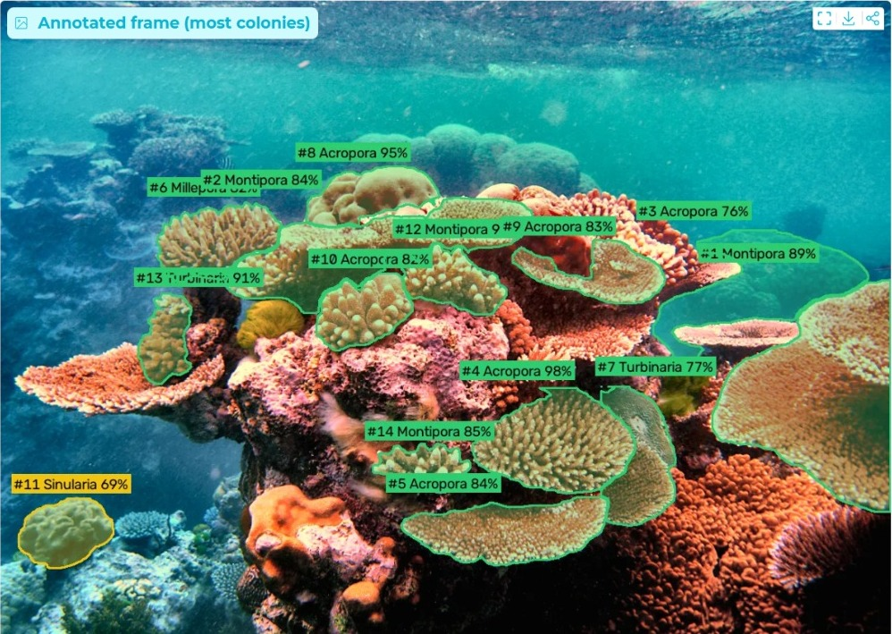
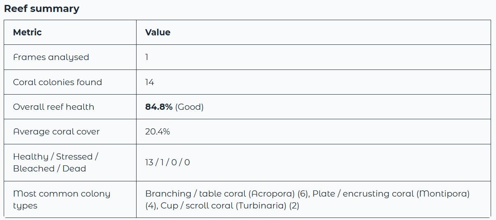
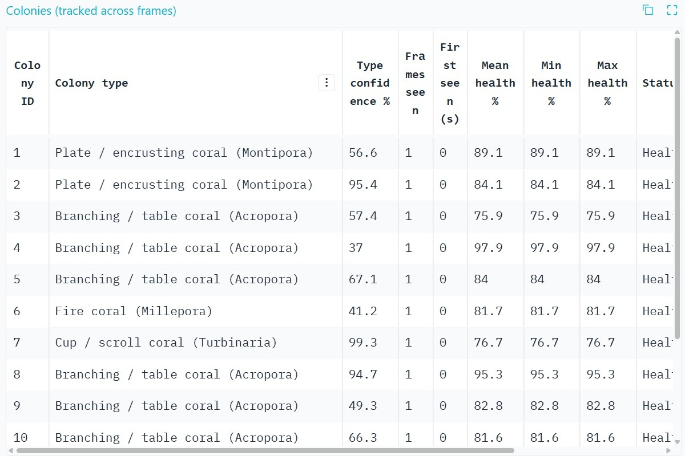
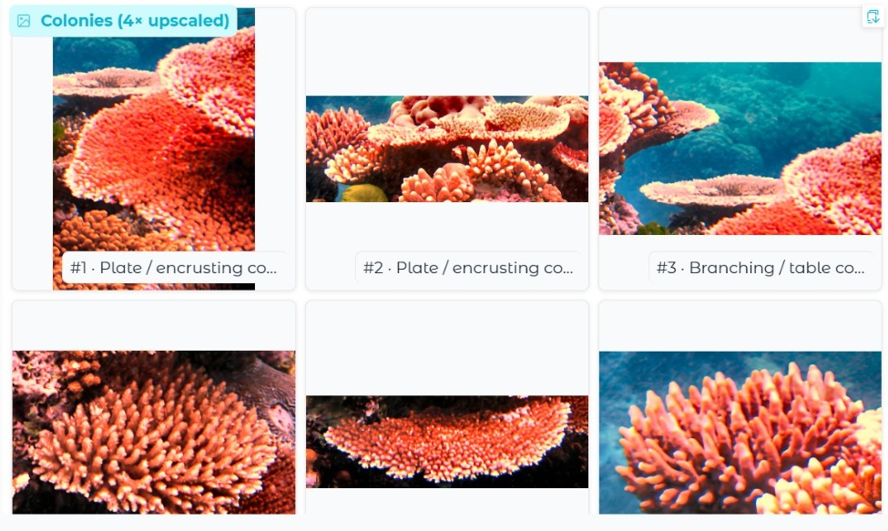
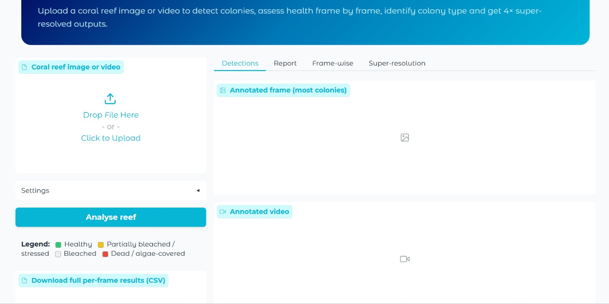

# 🪸 Reef Check

**Find coral colonies in reef photos and video, score their health, and sort them by growth form, with no pretrained models.**

Reef Check takes a reef image or video, finds the coral colonies in it, tracks each colony across frames, and reports for every colony:

1. **Health**: Healthy, Partially bleached / stressed, Bleached, or Dead / algae-covered, with a 0–100% health score.
2. **Type**: a coarse growth-form category, decided from shape and texture and labeled with a typical genus for that form: Branching / table (Acropora), Massive / boulder (Porites), Plate / encrusting (Montipora), Cup / scroll (Turbinaria), Soft / leather (Sinularia), Fire coral (Millepora). This is a growth-form guess, not species identification.

Nothing in the notebook downloads pretrained weights. Every step is classical computer vision or a model fit from scratch on the input itself.

[](https://colab.research.google.com/github/tvishaaprabhu/reef-check/blob/main/reef_check.ipynb)



---

## How It Works

```
Video / image
     │
     ▼
Frame sampling  (e.g. 1 frame per second)
     │
     ▼
Enhancement  (gray-world white balance + CLAHE)
     │
     ▼
SLIC superpixels  →  region-adjacency-graph color merging
     │
     ▼
Per-image KMeans (k=3)  →  coral vs. background regions
     │
     ▼
Health: HSV pixel rules      Type: shape + GLCM texture rules
     │
     ▼
Colony tracker  (box-IoU matching across frames)
     │
     ▼
Optional 4× super-resolution  (CNN trained on the input itself)
     │
     ▼
Annotated video  +  report tables  +  CSV
```

| Task | Approach |
|---|---|
| Colony **detection** | SLIC superpixels merged by mean color on a region adjacency graph. Each region gets Lab color, hue, saturation and Canny edge density features. A `KMeans(k=3)` fit fresh on each image splits coral from background (largest, smoothest cluster = background), and blue-cyan low-texture regions are also dropped. |
| Colony **health** | Rule-based scoring from HSV statistics inside each colony mask: bleached-white %, algae/dead %, vivid living-tissue %. |
| Colony **type** | Shape descriptors (compactness, solidity, eccentricity, extent, skeleton branch density) plus GLCM homogeneity/contrast, scored by a hand-written weighted rule. |
| **Tracking** | Greedy box-IoU matcher (threshold 0.25, 3-frame memory). Type is decided by confidence-weighted voting across frames, and health is averaged. |
| **Super-resolution (4×)** | `TinySRNet`, a small residual pixel-shuffle CNN with randomly initialized weights, trained for ~250 steps on blurred/downsampled crops of the uploaded frames ("zero-shot" internal learning). |

---

## Health Scoring

For each colony, every pixel is labeled from its HSV value:

- **White / bleached:** S < 45 and V > 150
- **Algae / dead:** green-yellow hue (30–95), or dark and gray (S < 60, V < 110)
- **Vivid tissue:** S > 70 and 40 < V < 235

```
Health % = 100 × (0.6·vivid + 0.25·(1 − white) + 0.15·(1 − algae))
```

| Condition | Status |
|---|---|
| algae > 35% and Health % < 55 | 🔴 Dead / algae-covered |
| Health % ≥ 70 | 🟢 Healthy |
| 45 ≤ Health % < 70 | 🟡 Partially bleached / stressed |
| Health % < 45 | ⚪ Bleached |

Overall reef grade, from the mean colony health: Good (≥ 70%), Fair (50–70%), Poor (30–50%), Critical (< 30%).

---

## Installation and Usage

1. Open `reef_check.ipynb` in Google Colab.
2. Optional: **Runtime → Change runtime type → T4 GPU** (CPU works, just slower).
3. Run all cells in order.
4. Open the public Gradio link printed at the end.
5. Upload a reef image or video and click **Analyze reef**.

Dependencies (installed by the first cell): `scikit-image, scikit-learn, opencv-python, imageio[ffmpeg], gradio, torch, pandas, numpy, Pillow`.

### App settings

| Setting | Effect |
|---|---|
| Frames analyzed per second | Video sampling rate |
| Max frames to analyze | Upper limit on frames processed |
| Minimum colony size | Smaller regions are ignored |
| Max colonies per frame | Keeps the largest N colonies |
| Super-resolution on/off, training steps | Controls the self-trained 4× upscaler |

---

## Outputs

- **Annotated image / video:** each colony outlined and shaded by status, labeled `#ID Type Health%`.
- **Reef summary:** frames analyzed, colonies found, overall health and grade, average coral cover, status counts, most common types.
- **Colony table:** ID, type, type confidence, frames seen, first seen, mean/min/max health, status.
- **Galleries:** key frames and colony close-ups (super-resolved if enabled).
- **CSV:** every detection with its color fractions, area and bounding box.

---

## Example Results

On a test photo (Coral Outcrop, Flynn Reef; Wikimedia Commons), the app found 14 colonies, gave the reef an overall health of 84.8% (Good), measured 20.4% coral cover, and marked 13 colonies Healthy and 1 Stressed.

| Reef summary | Per-colony table |
|---|---|
|  |  |





---

## Limitations

- **No ground-truth validation yet.** Health and type come from hand-set rules, so accuracy hasn't been measured against labeled data.
- **Color rules are lighting-sensitive.** Turbid water or deep footage shifts HSV values. Naturally yellow-green coral can be counted as algae.
- **Type is a growth-form guess, not species ID.** The genus names are typical examples of each growth form, and a 2D outline can fit more than one form.
- **Simple tracking.** Fast camera motion can split one colony into several IDs.
- **Not a biological trend.** Per-frame score swings come from camera angle and lighting. Real change needs repeat surveys weeks or months apart.
- **Screening tool,** not a substitute for expert reef assessment.

---

## Next Steps

- Measure detection IoU and health accuracy on the expert-labeled [Coralscapes](https://zenodo.org/records/15061505) dataset (Sauder et al., 2025).
- Train a classifier on the shape, texture and color features the pipeline already extracts.
- Learn health thresholds from labeled examples instead of setting them by hand.

---

## Project Structure

```
.
├── reef_check.ipynb     # enhancement, segmentation, scoring, tracking, super-resolution, Gradio app
├── requirements.txt
├── *.jpg               # example outputs
└── README.md
```
